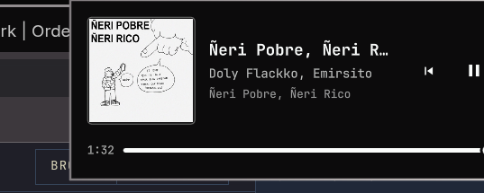

# Media — MPRIS now-playing for the Omarchy bar

A live `cava` audio spectrum in the bar with the current track's cover art in a
small circle, and a panel with cover, title / artist / album, transport
controls and a seek bar that follows playback position. Everything comes from
[MPRIS](https://specifications.freedesktop.org/mpris-spec/latest/), so it
follows whatever is playing — a local player, a browser tab, anything that
exposes the interface.



## What it does

- **In the bar:** a live cava spectrum with the cover art in a circle on top,
  falling back to a music glyph when the track has no art. The widget only
  exists while a player has something to show, so the bar goes back to normal
  when nothing is playing.
- **The panel:** cover art, title / artist / album, previous / play-pause /
  next, and a draggable seek bar with elapsed and total time.
- **Picks the right player.** A playing player wins over a paused one, proxy
  players (`playerctld`) are ranked last, and a paused player that still has
  metadata is the next best. Switching tracks re-seats the position bar.
- **Volume scroll** prefers the player's own MPRIS volume and falls back to the
  PipeWire default sink when the player does not expose one.

## Controls

| Where | Action |
|---|---|
| Bar | left click = open/close the panel · right click = play/pause · middle click = next track · scroll = volume |
| Panel | cover, title / artist / album, previous / play-pause / next, seek bar |

## Install

```sh
omarchy plugin add https://github.com/joseluiss2003/joseluis.media.git --enable --yes
```

Requires Omarchy 4 (Quattro) and `cava`. Any MPRIS player works — Spotify,
mpv, browsers, `cliamp`, and so on. No helper scripts and no extra packages
beyond `cava`.

To place it in a specific bar section:

```sh
omarchy plugin enable joseluis.media right
```

## Remove

```sh
omarchy plugin remove joseluis.media --yes
```

## IPC

```sh
omarchy-shell joseluis.media open
omarchy-shell joseluis.media close
omarchy-shell joseluis.media toggle
```

## How it works

`Media.qml` is the whole plugin. It reads the available players from
`Quickshell.Services.Mpris`, and runs one `cava` process per bar instance —
configured by the bundled `cava.conf` — parsing its ASCII output into the
spectrum bars. The panel is a `KeyboardPanel` (layer-shell), so it opens from a
click and from keyboard-summoned routing alike.

## License

MIT
